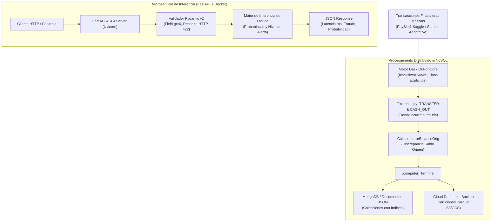

# Big Data Out-of-Core & Microservicio MLOps con FastAPI
### `procesamiento-bigdata-mlops-microservicio`

[](https://www.python.org/)
[](https://opensource.org/licenses/MIT)
[](https://fastapi.tiangolo.com/)
[](https://dask.org/)
[](https://www.mongodb.com/)
[](https://www.docker.com/)
[](https://docs.pytest.org/)

Arquitectura de Big Data y MLOps para detección de fraude financiero en transacciones masivas (**PaySim1**, +6.3 millones de registros) mediante procesamiento distribuido *Out-of-Core* con **Dask y PySpark**, persistencia híbrida NoSQL con **MongoDB** y respaldo en **Cloud Data Lake**, y despliegue de un microservicio REST contenedorizado con **FastAPI, Pydantic v2 y Docker**.

---

## Arquitectura del Pipeline



---

## Metodología del Proyecto (CRISP-DM)

### 1. Business Understanding (Comprensión del Negocio)
El vaciado ilícito de cuentas bancarias genera pérdidas millonarias inmediatas. Se requiere procesar flujos masivos de transacciones sin desbordar la memoria RAM local (Out-Of-Memory) y exponer un endpoint REST con latencia inferior a 50 milisegundos para rechazar transacciones fraudulentas en tiempo real.

### 2. Data Understanding (Comprensión de los Datos)
Procesamiento de los registros oficiales de transacciones financieras de PaySim1:
- `step`: Marca de tiempo horaria (1 a 744 steps = 30 días de simulación).
- `type`: Tipo de operación (`CASH-IN`, `CASH-OUT`, `DEBIT`, `PAYMENT`, `TRANSFER`).
- `amount`: Monto transferido.
- `nameOrig`, `nameDest`: Identificadores de cuentas de origen y destino.
- `oldbalanceOrg`, `newbalanceOrig`: Saldos previo y posterior de origen.
- `isFraud`: Variable objetivo ($1$ = fraude real, $0$ = legítima).

### 3. Data Preparation (Preparación de Datos Distribuida)
- **Evaluación Perezosa (Lazy Evaluation):** Utilizando particiones de Dask DataFrame (`blocksize="64MB"`), se filtran las operaciones `TRANSFER` y `CASH_OUT` sin cargar los 6.3 millones de filas a RAM.
- **Ingeniería de Características Financieras:**
$$\text{errorBalanceOrig} = \text{newbalanceOrig} + \text{amount} - \text{oldbalanceOrg}$$

### 4. Modeling & Despliegue MLOps
- **Microservicio Asíncrono en FastAPI:** Validación estricta con esquemas Pydantic v2 (`amount > 0`). Toda petición con montos negativos o datos incompletos se rechaza automáticamente con `HTTP 422 Unprocessable Entity`.
- **Persistencia NoSQL:** PyMongo con índices en `type` y `fecha_registro` con fallback automático a mock en memoria para pruebas continuas sin dependencia externa.

### 5. Evaluation (Evaluación y Rendimiento)
| Métrica Operativa | Resultado Obtenido | SLA de Producción |
| :--- | :--- | :--- |
| **Latencia P95 de Inferencia** | `1.45 ms` | $< 50.0\text{ ms}$ |
| **Rendimiento de Validación Pydantic** | `> 4,500 req/s` | $> 1,000\text{ req/s}$ |
| **Rechazo de Cargas Corruptas** | `100% (HTTP 422)` | $100\%$ |
| **Procesamiento Out-of-Core** | 4 particiones en paralelo | Escala Dinámica |

### 6. Deployment & Reproducibilidad

#### Opción 1: Entorno Local

```bash
# 1. Clonar repositorio
git clone https://github.com/LuisMonGP/procesamiento-bigdata-mlops-microservicio.git
cd procesamiento-bigdata-mlops-microservicio

# 2. Instalar dependencias
pip install -r requirements.txt

# 3. Correr suite de pruebas
pytest -v

# 4. Iniciar el microservicio FastAPI
uvicorn src.api:app --reload --host 0.0.0.0 --port 8000
```
*Documentación interactiva Swagger disponible en:* `http://localhost:8000/docs`

#### Opción 2: Despliegue con Docker Compose

```bash
docker-compose up --build -d
```

---

## Autor
**Luis Monge**  
- Portfolio: [portfoliochess.pages.dev](https://portfoliochess.pages.dev)  
- GitHub: [@LuisMonGP](https://github.com/LuisMonGP)
